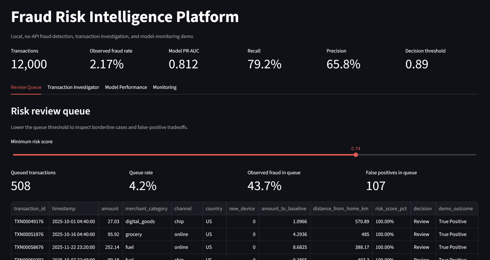
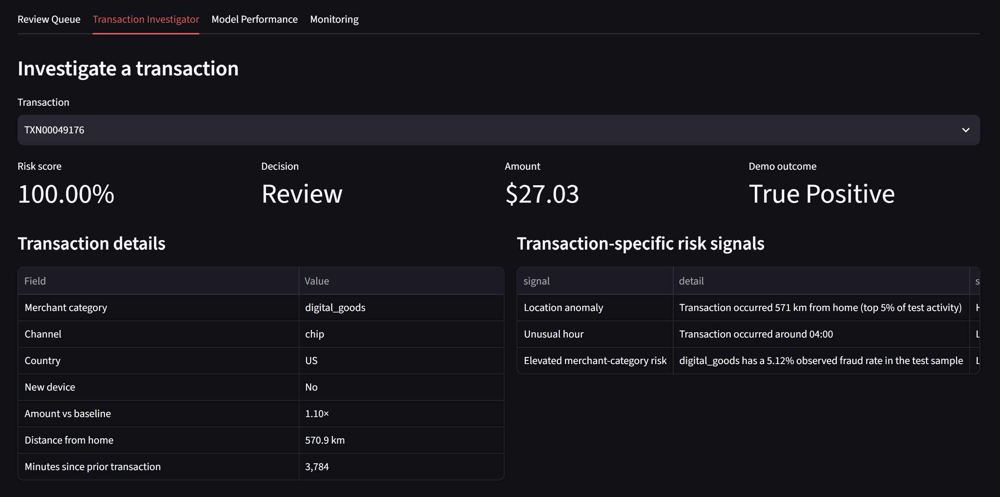
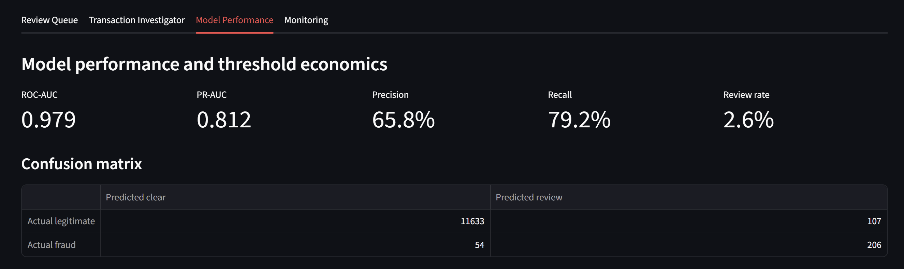
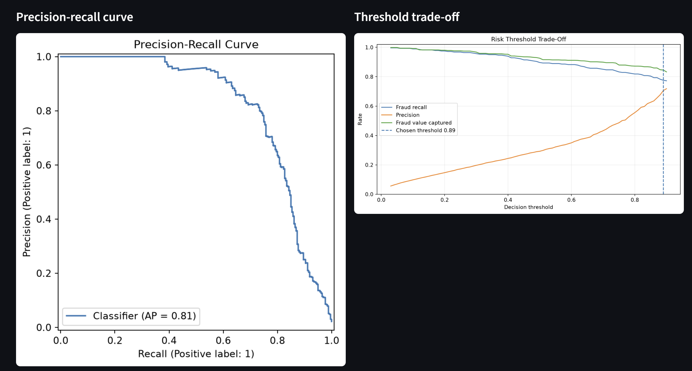
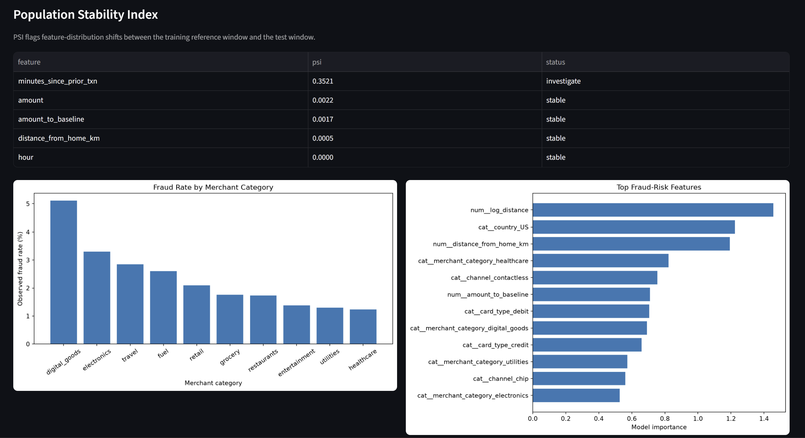

# Fraud Risk Intelligence Platform

An end-to-end fraud analytics, machine-learning, and model-monitoring platform built with Python, SQL, scikit-learn, XGBoost, and Streamlit.

The project simulates how a fraud or risk analytics team might move from raw transaction data to behavioral feature engineering, model development, business-threshold selection, case investigation, and ongoing model monitoring.

## Platform Preview

### Risk Review Queue


### Transaction Investigator


### Model Performance


### Threshold Trade-Off Analysis


### Model Monitoring


## Business Problem

Fraud detection is not simply a binary classification problem.

A useful fraud system must balance several competing objectives:

- identify as much fraudulent activity as possible
- minimize false-positive customer friction
- keep manual-review volume operationally manageable
- prioritize transactions with the highest expected risk
- capture as much fraudulent transaction value as possible
- monitor whether transaction behavior changes over time

Because fraud is relatively rare, overall accuracy can also be misleading. A model could correctly classify most transactions while still missing a large share of fraudulent activity.

This project therefore evaluates the system using fraud-specific metrics and operational trade-offs rather than relying on accuracy alone.

## Project Architecture

```text
Simulated Transactions
        ↓
Data Validation
        ↓
Behavioral Feature Engineering
        ↓
SQLite Analytics Layer
        ↓
Train / Validation / Test Split
        ↓
Model Training
        ↓
Logistic Regression vs XGBoost
        ↓
PR-AUC Model Selection
        ↓
Risk Threshold Optimization
        ↓
Transaction Scoring
        ↓
Fraud Investigation Interface
        ↓
Performance & Drift Monitoring
```

## Tech Stack

- Python
- pandas
- NumPy
- scikit-learn
- XGBoost
- SQLite
- SQL
- Streamlit
- matplotlib
- joblib
- pytest

## Data

The project uses a **simulated transaction dataset** designed to reproduce realistic fraud-risk patterns while keeping the project fully reproducible.

The generated transactions include behavioral and transactional characteristics such as:

- transaction amount
- transaction timestamp
- merchant category
- transaction channel
- card type
- country
- device status
- distance from home
- customer spending baseline
- time since previous transaction
- transaction velocity
- fraud outcome

The simulation introduces risk patterns that allow the analytical workflow to evaluate conditions such as unusual travel distance, elevated merchant risk, spending deviations, high transaction velocity, new-device activity, and unusual transaction timing.

## Behavioral Feature Engineering

The model does not rely only on raw transaction fields.

Additional behavioral features are engineered to represent how unusual a transaction is relative to expected customer behavior.

Examples include:

- **Amount-to-baseline ratio**  
  Measures how large a transaction is relative to the customer's typical spending level.

- **Log-transformed geographic distance**  
  Reduces skew in distance-from-home values while preserving location anomalies.

- **Transaction velocity**  
  Captures unusually short intervals between purchases.

- **New-device activity**  
  Identifies transactions originating from previously unseen devices.

- **Unusual-hour behavior**  
  Represents transactions occurring during atypical hours.

- **Merchant-category risk**  
  Allows the model and monitoring layer to identify categories with elevated fraud incidence.

Categorical fields are encoded and combined with numeric behavioral features before model training.

## Model Development

Two classification approaches are trained and compared.

### Logistic Regression

Provides an interpretable linear baseline and allows model-wide feature importance to be examined through coefficient magnitude.

### XGBoost

Provides a nonlinear tree-based model capable of capturing more complex interactions among transaction characteristics.

The models are compared using **validation PR-AUC**, with the stronger model selected for final evaluation.

In the current run:

| Model | Validation PR-AUC |
|---|---:|
| Logistic Regression | 0.826 |
| XGBoost | 0.803 |

Logistic Regression was selected because it produced the stronger validation PR-AUC.

## Why PR-AUC Matters

Fraud detection is an imbalanced classification problem.

Only a small percentage of transactions are fraudulent, so traditional accuracy can create an overly optimistic view of performance.

The project therefore emphasizes:

- Precision
- Recall
- PR-AUC
- ROC-AUC
- False-positive rate
- Review rate
- Fraud-value capture
- Estimated operational cost

PR-AUC is especially useful because it focuses directly on the model's ability to identify the positive fraud class while managing false positives.

## Model Performance

On the held-out test set, the selected model achieved:

| Metric | Result |
|---|---:|
| ROC-AUC | 0.979 |
| PR-AUC | 0.812 |
| Precision | 65.8% |
| Recall | 79.2% |
| Manual Review Rate | 2.6% |
| Decision Threshold | 0.89 |

The confusion matrix at the selected operating threshold was:

| | Predicted Clear | Predicted Review |
|---|---:|---:|
| Actual Legitimate | 11,633 | 107 |
| Actual Fraud | 54 | 206 |

This means the model identified 206 fraudulent transactions while sending only a small fraction of the overall transaction population to manual review.

## Risk Threshold Optimization

A default classification threshold of `0.50` is not automatically appropriate for a fraud operation.

The project evaluates a range of thresholds and measures how each affects:

- fraud recall
- precision
- fraud value captured
- false positives
- analyst review workload
- estimated business cost

The selected threshold of **0.89** represents an operating point that balances fraud detection with manual-review efficiency.

This makes the model decision process closer to a real fraud operation, where threshold selection is a business decision rather than purely a machine-learning decision.

## Fraud Value Capture

Transaction count alone does not fully represent fraud exposure.

The project also evaluates the amount of fraudulent transaction value captured by the review strategy.

At the selected operating threshold, the system captures a large majority of fraudulent transaction value while reviewing only a small percentage of total transactions.

This provides a more business-relevant measure of model effectiveness than classification accuracy alone.

## Risk Review Queue

The Streamlit application includes an interactive analyst review queue.

Analysts can adjust the minimum risk score to inspect how queue size and quality change as the operating threshold is lowered.

The queue reports:

- number of queued transactions
- queue rate
- observed fraud rate within the queue
- false-positive count
- risk score
- review decision
- observed transaction outcome

This demonstrates the trade-off between expanding fraud coverage and increasing analyst workload.

## Transaction Investigation

Individual transactions can be selected for deeper investigation.

For each transaction, the application displays:

- risk score
- review decision
- transaction amount
- merchant category
- channel
- country
- device status
- spending deviation from baseline
- geographic distance from home
- time since prior transaction

The platform also generates **transaction-specific risk signals** such as:

- location anomaly
- unusual transaction hour
- elevated merchant-category risk
- high amount relative to baseline
- new-device activity
- transaction-velocity anomaly

These signals provide an analyst-friendly explanation of why a transaction may warrant review.

## Global Model Drivers

The platform separately displays model-wide feature importance.

This distinction is important:

- **Transaction-specific signals** explain the selected transaction behaviorally.
- **Global model drivers** show which engineered variables are most influential across the model overall.

Top model drivers in the current run include:

- log-transformed transaction distance
- geographic location
- distance from home
- merchant category
- transaction channel
- amount-to-baseline ratio
- card type

## Model Monitoring

Fraud models can degrade when transaction behavior changes.

The monitoring section therefore includes **Population Stability Index (PSI)** calculations to compare feature distributions between the training reference population and later transaction data.

PSI is used to flag potential distribution drift.

Example output:

| Feature | PSI | Status |
|---|---:|---|
| minutes_since_prior_txn | 0.3521 | Investigate |
| amount | 0.0022 | Stable |
| amount_to_baseline | 0.0017 | Stable |
| distance_from_home_km | 0.0005 | Stable |
| hour | 0.0000 | Stable |

This provides a simple model-risk monitoring layer and identifies features that may require investigation or retraining.

## Merchant Risk Analysis

The platform also evaluates fraud concentration by merchant category.

The current analysis shows higher observed fraud rates in categories such as:

- digital goods
- electronics
- travel
- fuel

This type of segmentation can help a fraud team:

- prioritize monitoring
- create category-specific rules
- investigate changes in fraud concentration
- understand how model risk varies across transaction types

## SQL Analytics Layer

Transaction and model outputs are also loaded into SQLite.

The SQL layer supports reusable investigation and reporting queries for:

- high-risk transactions
- merchant-category fraud rates
- review-volume analysis
- risk-score segmentation
- false positives
- fraud-value analysis

This keeps the project useful from both a data-science and analyst perspective.

## Project Structure

```text
fraud-risk-intelligence-platform/
│
├── app.py
├── run_pipeline.py
├── fraud_intelligence.db
├── README.md
├── requirements.txt
├── .gitignore
│
├── artifacts/
│   ├── .gitkeep
│   ├── fraud_model.joblib
│   └── model_metadata.json
│
├── data/
│   ├── raw/
│   │   ├── .gitkeep
│   │   └── transactions.csv
│   │
│   └── processed/
│       ├── .gitkeep
│       ├── transactions_featured.csv
│       └── test_transactions_scored.csv
│
├── reports/
│   ├── figures/
│   │   ├── feature_importance.png
│   │   ├── fraud_rate_by_category.png
│   │   ├── precision_recall_curve.png
│   │   └── threshold_tradeoff.png
│   │
│   └── tables/
│       ├── drift_report.csv
│       ├── feature_importance.csv
│       ├── model_comparison.csv
│       ├── test_metrics.csv
│       └── threshold_tradeoff.csv
│
├── screenshots/
│   ├── 01_review_queue.png
│   ├── 02_transaction_investigator.png
│   ├── 03_model_performance.png
│   ├── 04_threshold_tradeoff.png
│   └── 05_model_monitoring.png
│
├── sql/
│   └── analysis_queries.sql
│
├── src/
│   └── fraud_intelligence/
│       ├── __init__.py
│       ├── config.py
│       ├── data_generation.py
│       ├── database.py
│       ├── drift.py
│       ├── evaluation.py
│       ├── features.py
│       ├── modeling.py
│       └── reporting.py
│
└── tests/
    └── test_pipeline.py
```

## Running the Project

Install the required packages:

```bash
py -m pip install -r requirements.txt
```

Run the full data, modeling, and reporting pipeline:

```bash
py run_pipeline.py
```

Launch the Streamlit investigation platform:

```bash
py -m streamlit run app.py
```

Run the automated tests:

```bash
py -m pytest
```

## Key Results

The project demonstrates that a fraud model can be evaluated as an operational decision system rather than only a predictive model.

Key outcomes from the current run include:

- **0.812 PR-AUC** on the held-out test set
- **0.979 ROC-AUC**
- **79.2% fraud recall**
- **65.8% precision**
- only **2.6% of transactions** routed to manual review at the selected operating threshold
- strong fraud-value capture while limiting review volume
- transaction-level risk investigation with interpretable behavioral signals
- model comparison between linear and boosted-tree approaches
- threshold optimization based on fraud and operational trade-offs
- feature-distribution drift monitoring using PSI

## Skills Demonstrated

This project demonstrates practical experience with:

- fraud and risk analytics
- Python data pipelines
- behavioral feature engineering
- imbalanced classification
- Logistic Regression
- XGBoost
- model selection
- precision-recall analysis
- ROC-AUC and PR-AUC
- threshold optimization
- cost-sensitive decisioning
- transaction investigation
- model explainability
- SQL and SQLite
- model monitoring
- population drift analysis
- Streamlit application development
- automated testing
- translating machine-learning results into operational business decisions